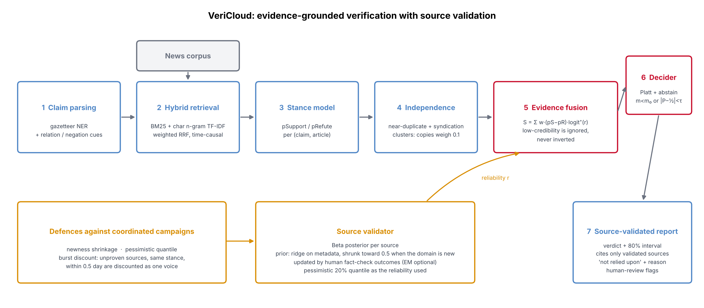

# VeriCloud: evidence-grounded news verification with source-validated reporting

[](https://github.com/RakshitRPathak/VeriCloud/actions/workflows/ci.yml)

*(Formerly "NewsCloud"; renamed on request. Package: `vericloud`, class: `VeriCloud`.)*



A complete, runnable reference implementation and simulation study: parse a news claim, retrieve time-causal evidence, judge each article's stance, discount copies and coordinated campaigns, weigh sources by *learned* reliability, and return a calibrated verdict (SUPPORTED / REFUTED / NOT ENOUGH INFO) with a report that cites only validated sources.

> **Read this first: scope and honesty.**
> * This is **one possible design** of VeriCloud, built from a short description of the project. It is not a copy of any existing system. Reconcile it with your real architecture before quoting it as "the" system.
> * All numbers come from a **synthetic, simulated news world** (`vericloud/world.py`), not real news. They show how the mechanisms behave against known ground truth and known attackers. They are not evidence of real-world accuracy.
> * The stance model is a gradient-boosted classifier on gazetteer and cue features, not an NLI transformer. Retrieval is BM25 plus character n-gram TF-IDF, not a dense retriever. Swap in real components at the interfaces listed below before making real-data claims.
> * The world was tuned by me until baselines failed in plausible ways under attack. Treat "VeriCloud beats baselines under attack" as a property of this simulator, and say so in a paper.

## What is in the box

```
vericloud/            library
  world.py            synthetic world: 6 source types + 800 sybil accounts, syndication, copies, decoys, fact-checkers,
                      typos, distractors, boost/smear campaigns, adaptive attackers (aged domains, slow drip)
  textproc.py         gazetteer NER + cue lexicon claim/article parser
  retrieval.py        hybrid BM25 + char n-gram TF-IDF (+ optional LSA), weighted RRF, time-causal
  stance.py           stance model (HistGradientBoosting, 17 pair features)
  independence.py     near-duplicate / syndication clustering (copies get weight 0.1)
  sources.py          source validator: Beta posteriors, metadata prior, newness shrinkage, optional EM
  fusion.py           log-odds fusion, Platt calibration, abstention gates, burst discount
  pipeline.py         VeriCloud class and Config
  report.py           source-validated report (cites only sources with credible lower bound >= 0.62)
  benchmark.py        baselines, oracles, evaluation harness   metrics.py  ECE, risk-coverage, F1
experiments/          exp1..exp6 (one script each)
tests/                23 unit/integration tests
results/              tables (md + LaTeX), figures (PNG + PDF), raw CSV/JSON, sample reports, logs
verify_cli.py         command line: verify a claim, list claims, run an attack demo
demo.py               one command (~1 min): baselines vs VeriCloud on the same claims, clean vs attacked, with example reports
docs/PAPER_NOTES.md   experiment-to-section map, claim wording the evidence supports, threats to validity, what to add before submission
run_all.sh            reproduces everything (about 18 minutes on 2 CPU cores)
```

## Method in brief

1. **Claim parsing.** Gazetteer lookup finds subject and object entities; sentence-level cues give the relation, negation and hedging.
2. **Retrieval.** BM25 and char n-gram TF-IDF are fused with weighted reciprocal-rank fusion. Only articles published before the claim time are visible.
3. **Stance.** Each (claim, article) pair gets pSupport and pRefute, with a neutral remainder.
4. **Independence.** Articles with TF-IDF cosine >= 0.8, or an explicit syndication tag, form a cluster. Copies get weight 0.1.
5. **Source validation.** Each source has a Beta posterior. The prior is a ridge model on metadata (age, volume, type, and so on), shrunk toward 0.5 for domains under one year old. Human fact-check outcomes update the posterior. A truth-discovery EM step is available but off by default (see E3).
6. **Fusion.** `S = sum_i w_i (pS - pR) * max(logit(r_i), 0)`, and the evidence mass is `m = sum_i w_i (pS + pR)`. Low-credibility sources are ignored, never inverted.
7. **Defences.** A pessimistic reliability quantile (20%), newness shrinkage, and a collusion-aware burst discount (unproven sources, same stance, within 0.5 day).
8. **Decision.** Platt calibration with a positive slope. It abstains (NOT ENOUGH INFO) when evidence mass or margin is too small; the thresholds are tuned for macro-F1 on a validation split. Monte-Carlo sampling of the reliabilities gives a credible interval and a verdict-flip probability.
9. **Report.** Verdict, interval, validated sources relied upon, other sources "not relied upon" with the reason, and flags for human review (coordinated burst, single-source verdict, high flip probability).

**Protocol.** Claims are split by time: 50% history, 20% validation, 30% test. Human labels are used only from history. 8 seeds for E1, 6 for E4, 4 for E2, E2b and E3; Wilcoxon signed-rank tests are paired by seed.

## Results (synthetic world; mean ± std over seeds)

### E1: main benchmark, macro-F1 (accuracy and ECE in `results/tables/e1_*.md`)

| Method | Clean | Under attack (30% of claims targeted, 10 sybil articles each) | Attack + noisy stance model |
|---|---|---|---|
| Top-1 evidence | 0.779±0.006 | 0.700±0.011 | 0.611±0.012 |
| Majority vote | 0.797±0.008 | 0.579±0.062 | 0.494±0.058 |
| Credibility prior (no learning) | 0.798±0.013 | 0.674±0.022 | 0.596±0.017 |
| Truth discovery (EM, no independence) | 0.801±0.010 | 0.533±0.096 | 0.417±0.059 |
| **VeriCloud** | **0.801±0.015** | **0.790±0.013** | **0.677±0.016** |
| Oracle reliability (upper bound) | 0.816±0.010 | 0.824±0.016 | 0.719±0.009 |
| Oracle reliability + gold stance (upper bound) | 0.841±0.015 | 0.844±0.015 | 0.844±0.015 |

* **Clean world: VeriCloud only ties the baselines.** The difference to the best baseline is -0.0003 macro-F1 (p = 1.0). The gains are in robustness, not in clean accuracy.
* **Under attack:** +0.090 over the best baseline (Top-1), Wilcoxon p = 0.008, 8 of 8 seeds. **Attack + noisy stance model:** +0.067, p = 0.008.
* **Selective prediction (E5):** AURC 0.056 vs 0.28 for the credibility prior, 0.49 for majority vote and 0.49 for EM. ECE 0.028.

### E2: attack breadth and intensity (macro-F1)

Fraction of claims targeted (10 sybil articles each):

| Method | 0% | 15% | 30% | 45% | 60% |
|---|---|---|---|---|---|
| Majority vote | 0.789 | 0.686 | 0.575 | 0.483 | 0.498 |
| Top-1 evidence | 0.774 | 0.729 | 0.700 | 0.656 | 0.640 |
| Credibility prior | 0.792 | 0.724 | 0.679 | 0.610 | 0.580 |
| Truth discovery (EM) | 0.789 | 0.706 | 0.479 | 0.483 | 0.498 |
| **VeriCloud** | 0.799 | 0.789 | 0.796 | 0.800 | 0.814 |

VeriCloud stays roughly flat because the attack is built from fresh, unproven accounts, which the defences discount. See the caveat on adaptive attackers below.

### E2b: adaptive attackers (30% targeted, 10 articles each; macro-F1)

| Method | Naive (new domains, burst) | Aged domains | Slow drip (6 days) | Aged + slow drip |
|---|---|---|---|---|
| Majority vote | 0.515 | 0.504 | 0.719 | 0.721 |
| Top-1 evidence | 0.692 | 0.703 | 0.710 | 0.713 |
| Truth discovery (EM) | 0.477 | 0.468 | 0.771 | 0.722 |
| **VeriCloud** | 0.798 | 0.747 | 0.786 | 0.755 |
| VeriCloud without newness/burst defences | 0.695 | 0.680 | 0.761 | 0.743 |
| Oracle reliability | 0.827 | 0.823 | 0.823 | 0.822 |

**An attacker who ages domains and drips content slowly costs VeriCloud about 4 points of macro-F1.** It stays ahead of Top-1 evidence and Majority vote, but it is not immune. In the slow-drip column, truth-discovery EM (0.771) is on par with VeriCloud (0.786). Defences against a patient, well-funded attacker are an open problem.

### E3: how quickly source validation learns (4 seeds, attack setting)

| Human fact-checks | 0 | 50 | 100 | 200 | 400 | 700 |
|---|---|---|---|---|---|---|
| Spearman ρ, estimated vs true reliability | 0.476 | 0.505 | 0.551 | 0.612 | 0.627 | 0.679 |
| Downstream macro-F1 | 0.725 | 0.743 | 0.758 | 0.777 | 0.790 | 0.800 |

Learning is gradual. Optional EM soft counts give a similar curve, and EM alone with no labels is worse than the metadata prior (ρ 0.404 vs 0.476). That is why EM is off by default. The mean reliability assigned to sybil accounts is 0.64 at zero labels, so sybils are *not* separated by the metadata prior alone; the defences matter.

### E4: ablations (macro-F1, attack setting, 6 seeds; paired Wilcoxon vs full)

| Variant | Macro-F1 | Δ vs full | p |
|---|---|---|---|
| VeriCloud (full) | 0.800 | – | – |
| − burst discount | 0.756 | −0.044 | 0.031 |
| − newness shrinkage | 0.776 | −0.024 | 0.031 |
| − pessimistic quantile | 0.787 | −0.013 | 0.031 |
| − all three defences | 0.680 | −0.120 | 0.031 |
| − source learning (prior only) | 0.758 | −0.042 | 0.031 |
| − independence clustering | 0.803 | +0.003 | 0.44 |
| + EM (λ=0.1) | 0.798 | −0.002 | 0.06 |

**Independence clustering and EM did not help measurably in this simulator** (Δ within noise). I kept independence clustering for explainability (it drives the "near-duplicate" flag in reports) and left EM off. The three defences are what matter. Retrieval: BM25 + char n-grams gives recall@20 of 0.76 and macro-F1 0.792. LSA did not help (0.787), so it is off by default. The cosine threshold θ is flat between 0.8 and 0.97.

### E6: efficiency (2 CPU cores, pure Python/NumPy)

| Facts | Articles | Index build | p50 latency | p95 latency | Batch throughput |
|---|---|---|---|---|---|
| 500 | 3,043 | 0.7 s | 22 ms | 24 ms | 891 claims/s |
| 3,000 | 15,840 | 2.3 s | 19 ms | 24 ms | 460 claims/s |

Latency is for retrieve + stance + fuse + 100-sample Monte-Carlo interval. The world generator tops out at 3,000 facts (a fixed lexicon gives about 3.4k unique subject-relation keys), so efficiency was **not** tested beyond about 16k articles. Do not extrapolate to millions.

## Limitations (please keep these in any write-up)

1. Synthetic data. There is no real-news evaluation, and no human evaluation of the reports.
2. The simulator and the defences were developed together. The defences are targeted at the attack families the simulator contains (fresh sybils, bursts, correlated decoys). Real adversaries will differ.
3. Clean-world accuracy is a tie with simple baselines. The claimed benefit is robustness plus abstention and calibration.
4. The stance model sees a structured template language (about 99% stance accuracy in-world). Real text is far harder, and the 'noisy stance' setting only partly models that.
5. Claims are single-fact (subject, relation, object). Real claims are compound, vague or numeric.
6. Source-reliability ground truth is generated by the simulator. Real source reliability is not that clean.
7. Few seeds: 8 (E1), 6 (E4), 4 (E2, E2b, E3). The smallest possible two-sided Wilcoxon p is 0.0078 with 8 seeds and 0.031 with 6, so the p-values are coarse.

## Quick start

```bash
pip install -r requirements.txt
python3 -m pytest -q tests              # 23 tests
./run_all.sh                            # everything, ~18 min on 2 cores

python3 demo.py                         # 1-minute tour: who gets fooled by a sybil campaign and who does not
python3 verify_cli.py --list            # list claims in the demo world
python3 verify_cli.py --claim-id 5      # verify one
python3 verify_cli.py "Ironvale Motors acquired Maplecrest Motors"   # free text, parsed against the demo world
python3 verify_cli.py --claim-id 5 --attack   # inject a sybil campaign and compare
```

## Plugging in real components

* **Stance:** implement `predict_proba(table)` returning `pS`, `pR` per (claim, article) pair, for example from an NLI model (entail → support, contradict → refute). See `StanceModel` in `stance.py`.
* **Retrieval:** `HybridRetriever.search(queries, qtimes, k, ...)` returns ranked article ids. Replace it with a dense retriever or a search API. Keep the time-causal filter.
* **Sources:** feed real metadata (domain age, volume, type) to `fit_prior_model`, and real fact-check outcomes to `VeriCloud.learn_sources`.
* **Claims:** replace `parse_claim` with an LLM or claim-detection model.

## Mapping to a paper

Suggested contribution statements this code can support, if reconciled with your real system: (i) source validation with newness shrinkage and a pessimistic quantile; (ii) a collusion-aware burst discount; (iii) abstention gates with calibrated verdicts and flip probabilities; (iv) a report that separates relied-on from not-relied-on sources. Report the clean-world tie and the adaptive-attacker degradation alongside the wins.
